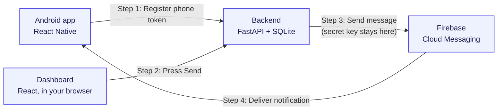

# Push Notification System

Send a notification from a web page on your laptop to your Android phone. It uses Firebase Cloud Messaging (FCM). Everything runs on your own computer.



**In short:** the phone tells the backend who it is (1). You press Send on the dashboard (2). The backend asks Firebase to send it (3). Firebase delivers it to your phone (4).

## What it does

- You type a title and a message, pick your phone, and press **Send Notification**.
- The phone's token is saved in a small database. It is always shown shortened, never in full.
- A history list shows every message you sent and what happened to it.
- If a phone token stops working, the backend marks that phone as inactive. A short network problem does not remove it.
- It works when the app is open, in the background, or closed.
- The secret Firebase key stays on the backend only. It is never in the app or in this repository.

## What it is made of

| Folder | Technology |
|---|---|
| `dashboard/` | React, Vite, TypeScript, Tailwind CSS |
| `backend/` | Python, FastAPI, Firebase Admin SDK, SQLite |
| `mobile/` | React Native, TypeScript, React Native Firebase, Notifee |

## Before you start

You need: Node 22 or newer, pnpm, Python 3.12, Java 17, the Android SDK, and a Firebase project with an Android app.

1. Put your `google-services.json` file in `mobile/android/app/`.
2. Save your Firebase Admin key somewhere outside this project, for example `~/.config/fcm-push-notifications/service-account.json`.
3. Copy `backend/.env.example` to `backend/.env`. Set `GOOGLE_APPLICATION_CREDENTIALS` to the full path of that key.

## How to run it

Use a separate terminal for each step that keeps running.

### Step 1: Start the backend

```bash
./scripts/start-backend.sh
```

Runs at http://127.0.0.1:8000. Check it with `curl http://127.0.0.1:8000/api/health`.

### Step 2: Start the dashboard

```bash
./scripts/start-dashboard.sh
```

Open http://localhost:5173 in your browser.

### Step 3: Connect your phone

Plug in your phone with a USB cable and turn on USB debugging. Then run:

```bash
adb devices                       # your phone should say "device"
adb reverse tcp:8000 tcp:8000     # lets the phone reach the backend
adb reverse tcp:8081 tcp:8081     # lets the phone reach Metro
```

### Step 4: Build and install the app

```bash
cd mobile
pnpm install                      # first time only
pnpm start                        # keep this running (Metro)
```

In a second terminal:

```bash
cd mobile
pnpm android                      # builds and installs the app on your phone
```

### Step 5: Send your first notification

1. Open the app on your phone and allow notifications.
2. Your phone appears in the dashboard.
3. Choose it, type a message, and press **Send Notification**.

No USB cable? In the app, open **Settings** and change the backend address:
- Emulator: `http://10.0.2.2:8000`
- Same Wi-Fi: `http://<your laptop IP>:8000` (start the backend with `HOST=0.0.0.0 ./scripts/start-backend.sh`)

## How a message reaches the phone

| App state | Who shows the notification |
|---|---|
| Open | The app itself |
| Background or closed | Android itself |

When the dashboard says "accepted by Firebase", it means Firebase received the message. It does not prove that the phone showed it yet.

**Important:** delivery is never guaranteed. It can fail if the phone is offline, if notifications are turned off, or if the app was force-stopped (Android blocks it until you open the app again). Some phone brands also stop background apps to save battery.

## API

| Method | Address | What it does |
|---|---|---|
| GET | `/api/health` | Shows if the backend is working |
| POST | `/api/devices/register` | Saves a phone token |
| GET | `/api/devices` | Lists phones (tokens shortened) |
| POST | `/api/notifications/send` | Sends a notification |
| GET | `/api/notifications` | Shows recent messages |

## Tests

**Backend** (Firebase is faked, so nothing is really sent):

```bash
cd backend
source .venv/bin/activate
python -m pytest -q
```

**Dashboard:**

```bash
cd dashboard
pnpm build
pnpm lint
```

**Mobile app:**

```bash
cd mobile
npx tsc --noEmit
pnpm lint
```

## Common problems

**Dashboard says "backend offline"**
Start the backend first (Step 1).

**The app cannot register**
Run this again. It resets when you unplug the phone.

```bash
adb reverse tcp:8000 tcp:8000
```

**Install fails: not enough storage**
Build a smaller app for your phone's CPU:

```bash
cd mobile/android
./gradlew assembleDebug -PreactNativeArchitectures=arm64-v8a
```

**Gradle cannot find `gradle-plugin`**
Run `pnpm install` inside the `mobile/` folder.

**Health shows `firebase: not_configured`**
Check the key path in `backend/.env`.

**Message accepted, but nothing on the phone**
Check these, one by one:
- Notification permission is allowed
- Do Not Disturb is off
- Battery saver is not blocking the app
- The app was not force-stopped

## Keep it safe

Git ignores these files, and you must never upload them:

- `.env` files
- The Firebase Admin key
- `google-services.json`
- Signing keys, databases, and build files

Also:

- Never put the Admin key in `dashboard/` or `mobile/`.
- Do not open the backend to the internet.
